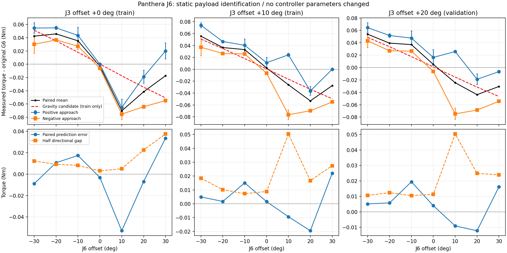

# Panthera J6 静态辨识结果

原始数据：`/home/a/ArmHub/logs/j6_identification/20261019T110339_223788Z`。离线分析，不连接机械臂，没有应用参数。

## 数据与验证

- 完成 42 点、1312 帧有效数据，原始帧/摘要均值校验通过，已确认停止保持。
- 每个有效窗口至少 2.001 秒；J6 点内最大标准差 0.01449 Nm。
- J3 偏移 0°/10° 的 28 个点训练；20° 的 14 个点只验证。每点等权，不随机拆连续帧。
- 本轮归一化训练条件数（含偏置）36.17。

## 有效重力修正候选

先将同组同角度的正反数据配对取均值，再拟合两个质量一阶矩，不把方向项或常量偏置混入重力：

```text
hy = -0.000419913 kg*m
hz = 0.010402241 kg*m
delta_G6 = -gz*hy + gy*hz
```

这里 gy/gz 为 link6 坐标系中的实际重力（m/s²）。以上物理单位以 SDK 力矩比例正确为前提。这是原模型误差与附加相机负载的有效合成修正，不是相机单独质量/三维重心。

验证集正反均值 RMSE：原模型 0.03644 Nm → 候选 0.01161 Nm，下降 68.1%。这是**配对均值**结果。对单方向保持力矩，重力候选验证 RMSE 为 0.02714 Nm；原始单方向验证基线为 0.04394 Nm。

## 尚未解释的方向相关误差

正反差值的一半平均 0.01811 Nm，范围 0.00299～0.05036 Nm。考虑常量偏置和接近方向后，方向系数 0.01689 Nm，单方向验证 RMSE 为 0.01847 Nm。

这表明方向相关效应显著，可能涉及静摩擦、回差、线缆或驱动反馈特性；当前实验不能唯一归因，也不能把静止时的接近方向项直接当作运动摩擦补偿。重力模型仍有约 0.01161 Nm 的配对验证误差，不能宣称完全消除下沉/上抬。

含偏置拟合得到的 hy 会明显变化，说明小量 hy 与常量偏置的区分较弱；所有模型参数及误差保存在 `fit_report.json`。

## 接下来

先用候选只修正 J6 重力项，在现有力矩限幅和反馈保护下比较新姿态补偿前后的效果，并记录静止漂移与残余力矩。当前未修改重力控制程序；`candidate_parameters.json` 的 enabled=false。其他关节负载效应、相机独立质量、完整重心和惯量均未辨识。


